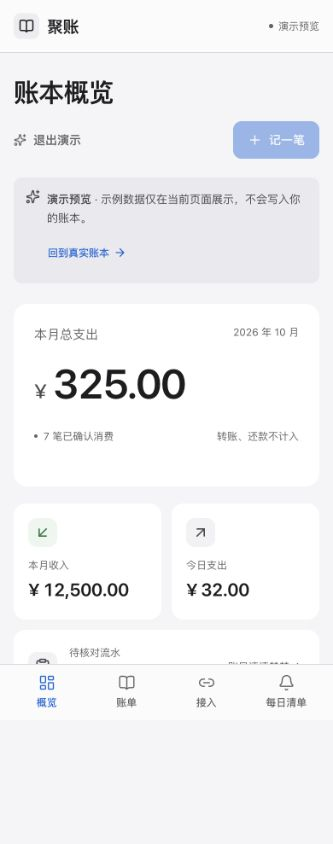
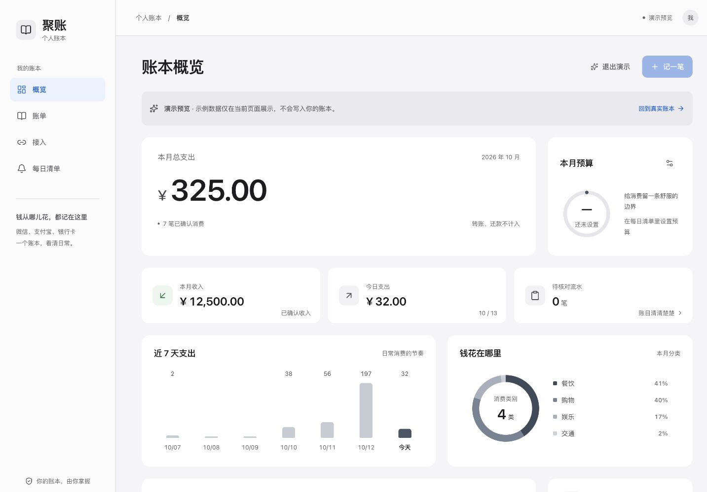
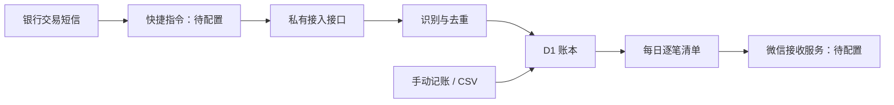

# 聚账

将微信、支付宝、银行卡等渠道的消费汇总到一本私人账本。聚账是 **iPhone 网页应用（PWA）**，可在 Safari 中添加到主屏幕，也支持电脑浏览器。

**账本、交易文本识别和每日清单后端已经完成；手机自动转发与真实微信推送仍待配置。** 收到交易文本后，聚账可以自动入账；它不会自行登录支付平台、抓取手机通知或读取历史短信。

[打开聚账](https://juzhang-20261012.silkyharp4.chatgpt.site/) · [当前进度与续接](docs/current-status.md) · [iPhone 自动化配置](docs/iphone-automation.md) · [开发与源码导航](docs/development.md) · [GitHub 同步说明](docs/github-sync.md) · [完整交接报告](docs/full-handover.md)

## 当前状态

截至 **2026-10-13（北京时间）**，生产网站已发布第 5 版，源码提交为 `41bde16ade4a6cfd4cf9b2d84b485261cb36c3f8`。GitHub 保存源码、迁移、测试、设计说明与续接文档；后续文档提交可能使仓库 HEAD 高于该生产提交。**GitHub 同步不会自动部署 Sites，也不会复制数据库、密钥或手机自动化。**

| 项目 | 状态 |
| --- | --- |
| 手机 / 电脑账本，白灰简洁界面 | 已发布 |
| 添加、编辑、删除确认和撤销 | 已实现并用合成账单验证 |
| 交易文本识别、CSV 导入与导出 | 已实现 |
| 待核对、保守去重、收入与账户转移区分 | 已实现 |
| 完整逐笔日报与推送适配器 | 已实现 |
| 每天 21:00 执行昨日清单任务 | 已保存并启用，接收端未配置时安全跳过 |
| 建行短信 → 聚账 | 接收快捷指令尚未安装，自动转发尚未启用 |
| 任意微信 / 支付宝 App 通知正文采集 | 尚未在实际手机验证 |
| 真实微信日报接收 | 接收凭据尚未配置，实际发送尚未验证 |

## 界面预览

截图使用合成演示账单，不代表真实消费或自动采集已经启用。





## 已实现的功能

- **多渠道汇总**：概览、账单、接入、每日清单四个页面；搜索、渠道 / 收支 / 月份筛选与预算。
- **交易文本识别**：提取金额、商户、渠道、时间和类别，使用本地规则，不调用大语言模型，因此不产生模型 token 消耗。
- **交易状态保护**：余额提醒、验证码、推广、失败交易不计为消费。未到账、待收款、处理中及用途不明的转账进入待核对；充值、提现、信用卡还款和自有账户转移不增加消费合计。
- **保守去重**：相同事件标识或可靠订单号用于幂等；绑卡支付与银行扣款疑似重复时保留待核对，不直接丢弃；多次退款不因共享原订单号被吞掉。
- **可修改与删除**：添加、编辑、确认、软删除与撤销。已删除记录退出统计、日报和导出；撤销保留原来的待核对状态及说明。
- **官方账单补录**：微信、支付宝及通用银行 CSV，文件读取支持 UTF-8 / GB18030，ZIP 先解压；可导出未删除账单。
- **完整日报**：已确认交易逐笔明细、渠道 / 分类汇总、账户转移明细和待核对笔数；自动日报取北京时间昨天完整自然日。
- **微信接收适配**：Server酱 SCT、PushPlus、企业微信群机器人；检查业务返回码、限制重试、长清单分段。服务受理不等于微信客户端已展示；SC3 对应独立 App。

## 怎么使用

1. 在 iPhone Safari 打开聚账，完成本人登录并打开账本；分享 → 添加到主屏幕。网站保持所有者私有访问。
2. 可以立即手动记账、导入 CSV、核对和删除。先退出演示预览再操作真实账本；样例 CSV 确认导入后也会写入真实账本。
3. 自动录入需在手机完成消息转发。当前优先方案是建设银行交易短信，发件号码候选为 `95533`、`106980095533`，详见 [iPhone 自动化说明](docs/iphone-automation.md)。
4. 在“每日清单”配置本人接收服务，先测试，再开启每日发送。既有任务每天北京时间 21:00 发送昨天清单；接收凭据未配置时不会发送。



**覆盖范围取决于实际消息入口。** 微信零钱、支付宝余额消费若没有可转发的交易正文，不能仅靠建行短信捕获，需要补录或后续验证新的采集方式。金额缺失、触发失败或消息未送达时也需要核对补账。

## 数据与备份

生产数据保存在 Sites D1 数据库，绑定为 `DB`。私有网站登录、账本所有者校验和接入请求头共同控制访问；推送凭据在服务端以 AES-GCM 加密保存，已保存明文不回显。

GitHub 保存的是可恢复的代码与工作说明。真实账单、数据库文件、登录会话、接入令牌、推送密钥、依赖与构建缓存不随源码上传。仓库本身不会运行每日任务，也不会替代生产数据库备份。Service Worker 只缓存公开图标，金融 API 和页面不用于离线缓存。

恢复或继续开发前先读 [当前进度](docs/current-status.md)，复用原私有网站、数据库与每日任务。部署到其他平台需另配鉴权、数据库、秘密和调度，不能作为无鉴权公开静态页运行。

## 开发

需要 Node.js `>=22.13.0` 和 npm。使用 React、TypeScript、Vinext / Vite、Cloudflare Workers / D1 与 Drizzle，目前部署适配 Sites。

```sh
npm run install:ci
npx tsc --noEmit
node --experimental-strip-types tests/ledger-domain.test.ts
node --experimental-strip-types tests/push-adapters.test.ts
npm run build
```

首次本地运行需应用数据库迁移，详见 [开发说明](docs/development.md)。`npm run db:generate` 只生成迁移，不会把表建进数据库。

## 源码与来源

核心文件：`app/ledger-client.tsx`（界面）、`lib/ledger-domain.ts`（识别、CSV、去重、日报）、`lib/ledger-store.ts`（存储与加密）、`lib/push-adapters.ts`（推送）、`app/api/[...path]/route.ts`（API）。完整导航见 [开发说明](docs/development.md#源码导航)。设计记录在 [PRODUCT.md](PRODUCT.md)、[DESIGN.md](DESIGN.md)、`.impeccable/design.json` 和 [视觉方向](docs/visual-direction.md)；调度约定见 [SCHEDULE.md](SCHEDULE.md)。

CSV 状态机、中文账单字段映射、通知解析和分类逻辑改编自 [zyz674/moneybook](https://github.com/zyz674/moneybook)，参考提交 `f8023c9931818222a495dce834aaa24ac9d9b089`。原项目为 MIT 许可，保留于 [moneybook-MIT.txt](THIRD_PARTY_LICENSES/moneybook-MIT.txt) 及改编模块中；模板与依赖各自的许可证也应保留。
